<div align="center">



<br /><br />

[](https://mr-farooqi.github.io/BlockBurst-Game/)
[](./index.html)
[](./index.html)
[](#controls--shortcuts)

</div>

---

## ✨ 3D Interactive Highlights

<div align="center">
  
</div>

---

## 🎮 Live Gameplay & Combo Mechanics

<div align="center">
  
</div>

### How It Plays
1. **8×8 Grid Board** — Starts completely empty. Each round deals **3 random, non-rotatable shapes** from **37 variants** across **14 distinct color-coded families** (`1×1`, `1×2`, `1×3`, `1×4`, `1×5`, `2×2`, `3×3`, `2×3`, small & big `L`-corners, `T`, `Z`, and `S` shapes).
2. **Smart Ghost Preview** — Dragging any piece onto the board shows a real-time **Green Ghost** for valid spots, a **Red Highlight** for collisions/out-of-bounds, and a **Golden Anticipation Glow** across any rows/columns about to clear.
3. **Mobile Touch-Lift** — On touch screens, dragged blocks automatically float slightly above your finger so your thumb never covers the target cell.
4. **Simultaneous Line Clears & Combos** — Complete full rows and/or columns at once to blast them away with 60fps canvas particles, beam flashes, and combo multipliers.
5. **Round Refill & Game Over** — After placing all 3 tray blocks, 3 fresh blocks appear. Game Over triggers when none of the remaining blocks fit anywhere on the board.

---

## 🏆 Scoring System

| Action | Points Formula | Example |
| :--- | :--- | :--- |
| **Place Block** | `cells × 10` | `2×2` (4 cells) = **+40 pts** |
| **1 Line Clear** | `1 × 100 × 1` | Single row or column = **+100 pts** |
| **2 Lines (`x2 COMBO!`)** | `2 × 100 × 2` | Row + Column intersection = **+400 pts** |
| **3 Lines (`x3 MEGA!`)** | `3 × 100 × 3` | Triple clear = **+900 pts** |
| **4+ Lines (`x4+ ULTRA!`)** | `lines × 100 × lines` | Quad clear = **+1,600 pts** |

> High Scores (`block_blast_best_score_v1`) and Sound Mute state (`block_blast_muted_v1`) persist automatically in `localStorage` (with a safe in-memory fallback for restricted `file://` contexts).

---

## 🕹️ Controls & Shortcuts

| Input | Action |
| :--- | :--- |
| **Mouse Drag & Drop** | Click and drag any block from the bottom tray onto the 8×8 board |
| **Touch Drag & Drop** | Touch and drag smoothly on mobile/tablet (`touch-action: none`) |
| **`P`** or **`Esc`** | Pause / Resume game |
| **`M`** | Mute / Unmute Web Audio API sound effects |
| **`R`** | Instant Restart |
| **`Enter`** or **`Space`** | Start Game / Play Again from menu or Game Over screen |

---

## 🧩 Architecture (Single-File Engine)

Everything lives inside a single standalone [`index.html`](./index.html) with zero build tools, zero CDNs, and zero external images or audio files:

```text
BlockBurst Game/
├── index.html          # Complete game (HTML5 + CSS3 + Vanilla JS + Web Audio + Canvas FX)
├── README.md           # Documentation with animated 3D isometric SVGs
└── assets/
    ├── hero-3d.svg     # Animated 3D isometric hero monument & title
    ├── gameplay-3d.svg # Animated 3D 8x8 board x2 combo line-clear simulation
    ├── features-3d.svg # Animated 3D floating feature cards
    └── footer-3d.svg   # Animated 3D horizon wave footer
```

<details>
<summary><b>🔍 Internal Modules Inside <code>index.html</code></b></summary>

- **`Storage`** — Safe `localStorage` wrapper with automatic in-memory fallback.
- **`Sound`** — Zero-file Web Audio API synthesizer generating `pickup`, `place`, `invalid`, `clear`, `refill`, and `gameOver` tones.
- **`SHAPE_CATALOG`** — 37 precomputed shape matrices across 14 color palettes.
- **`Particles`** — Hardware-friendly `<canvas>` particle burst engine (`requestAnimationFrame` auto-sleeps when idle).
- **`Engine`** — Pure board logic (`canPlace`, `placeShape`, `previewClears`, `findFullLines`, `clearLines`, `canAnyPieceFit`, `generateTray`).
- **Pointer Drag Controller** — Unified `pointerdown` / `pointermove` / `pointerup` / `pointercancel` pipeline with dynamic cell-metric snapping.

</details>

---

## 🚀 Run Locally or Deploy to GitHub Pages

### Option 1: Open Directly
1. Clone this repository:
   ```bash
   git clone https://github.com/Mr-Farooqi/BlockBurst-Game.git
   ```
2. Double-click **`index.html`** to play instantly in any modern browser — no `npm install` or server needed.

### Option 2: GitHub Pages
1. Push this repository to GitHub (`main` branch).
2. Open **Settings → Pages → Source: Deploy from a branch → `main` / `(root)`**.
3. Play live at: **`https://mr-farooqi.github.io/BlockBurst-Game/`**

---

<div align="center">
  
</div>
